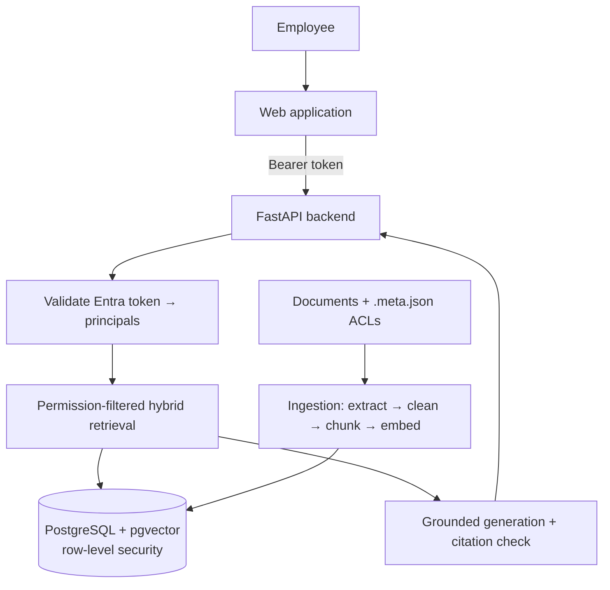

# Enterprise RAG — Secure Knowledge Assistant

An internal assistant for the fictional **Acme Corp**. Employees ask questions in natural language; answers are
generated **only** from documents they are authorized to read, with citations, or the assistant says it does not
have sufficient information.

| User | Question | Behavior |
|---|---|---|
| Marketing employee | What is our latest campaign strategy? | Answers from marketing documents |
| HR employee | What is our parental leave policy? | Answers from authorized HR documents |
| Marketing employee | What are the executive salaries? | Never sees restricted HR content |
| Finance employee | What is our Q3 budget? | Answers when the user's groups allow it |

Stack: FastAPI · Microsoft Entra ID (OAuth2/OIDC) · PostgreSQL + pgvector · Sentence Transformers ·
Azure OpenAI (or any OpenAI-compatible model) · PyMuPDF / python-docx · Docker · Kubernetes · Prometheus / Grafana ·
pytest. No LangChain or LlamaIndex: every component is implemented here so each decision is visible.

## Architecture



### Question answering (`POST /chat`)

1. **Authenticate**: the bearer token is validated against Entra ID's signing keys (signature, issuer, audience,
   tenant, expiry). The request body may contain only `question`; extra fields such as `groups` are rejected.
2. **Resolve permissions**: principals are `user:<oid>` plus `group:<id>` for every group in the token. If Entra
   emits a groups *overage* claim, groups are fetched from Microsoft Graph, or the request fails closed with 403.
3. **Retrieve**: in one read-only transaction, the principals are set with `set_config('app.principals', …, true)`,
   then vector search (pgvector, cosine) and keyword search (PostgreSQL full-text search) run with the same ACL
   filter. Results are fused with Reciprocal Rank Fusion. Vector hits that are too distant are dropped, so
   off-topic questions end in "insufficient information". An optional cross-encoder reranks.
4. **Generate**: authorized chunks become numbered, escaped `<source id="S1">` blocks. The system prompt says to
   answer only from them, cite `[S1]`, and treat sources as data, not instructions.
5. **Validate**: citations to sources that were never sent are stripped. An answer with no valid citation is
   replaced by the insufficient-evidence response. If nothing authorized was retrieved, the LLM is not called.

### Security model: defense in depth

The LLM must never receive content the user is not authorized to read. That is enforced at three layers:

| Layer | Mechanism | Where |
|---|---|---|
| Identity | Signed Entra token only; client-supplied groups rejected (422) | `app/auth/entra.py`, `app/api/routes/chat.py` |
| Application | `ACL_FILTER` (`is_public OR EXISTS acl`) in every retrieval query | `app/retrieval/common.py` |
| Database | Row-level security on `documents`, `document_acl`, `document_chunks` for the `rag_app` role; no principals set means no rows | `migrations/versions/0001_initial_schema.py` |

The API connects as `rag_app` (SELECT only, `NOBYPASSRLS`). Ingestion and migrations use `rag_admin`, the table
owner. `app.principals` is transaction-local, so it cannot leak to the next request on a pooled connection.
ACL changes apply on the next ingestion run without re-embedding (`metadata_updated`).

## Quick start (Docker Compose, dev auth)

```bash
cp .env.example .env
```

Set `DEV_JWT_SECRET` in `.env` (e.g. `openssl rand -hex 32`) and your Azure OpenAI endpoint and deployment, or an
OpenAI-compatible endpoint such as Ollama. Then:

```bash
make up
```

```bash
docker compose exec api python -m scripts.ingest_documents data/demo
```

```bash
eval "$(docker compose exec -T api python -m scripts.create_demo_users)"
```

```bash
curl -s localhost:8000/chat -H "Authorization: Bearer $TOKEN_MARKETING" -H 'Content-Type: application/json' -d '{"question": "What are the executive salaries?"}'
```

The marketing user gets the insufficient-evidence answer. Ask the same with `$TOKEN_EXECUTIVE` and the answer cites
`doc-hr-002`. `GET /documents` lists what the caller can read; `POST /documents` (multipart `file` + `metadata`
JSON) requires the `Documents.Admin` app role.

Monitoring: `make monitoring`, then Prometheus at `localhost:9090` and Grafana at `localhost:3000`.

## Local development

```bash
make install
```

```bash
make test
```

Integration tests run against PostgreSQL + pgvector and **drop and recreate the schema**, so point them at a
throwaway database (`make up` provides one):

```bash
make test-integration
```

```bash
make eval
```

`make eval` runs `eval/retrieval_eval.jsonl` through the real retriever and reports recall@k plus any forbidden
document retrieved (non-zero exit on a leak). Retrieval is evaluated separately from generation: if the right
evidence is never retrieved, no prompt change will fix the answer.

## Microsoft Entra ID setup

1. Register an app for the API. Under **Expose an API**, add a scope (e.g. `Chat.Ask`). In the manifest set
   `accessTokenAcceptedVersion` to `2`, so the token audience is the client ID.
2. Under **Token configuration**, add the `groups` claim (security groups). Document ACLs must then use the
   group **object IDs** in `allowed_groups`.
3. Add an app role `Documents.Admin` for knowledge administrators who may upload documents.
4. Set `AUTH_MODE=entra`, `ENTRA_TENANT_ID`, `ENTRA_AUDIENCE=<client id>`.
5. For users in more than ~200 groups, grant a confidential client `GroupMember.Read.All` (application) and set
   `GRAPH_CLIENT_ID` / `GRAPH_CLIENT_SECRET`. Without it, those users get 403 rather than incomplete permissions.

For Azure OpenAI, leave `AZURE_OPENAI_API_KEY` empty to authenticate with managed identity (`DefaultAzureCredential`).

## Document metadata

Each document has a sidecar `<file>.meta.json`:

```json
{
  "document_id": "doc-001",
  "title": "HR Compensation Policy",
  "department": "HR",
  "allowed_groups": ["hr-team", "executives"],
  "classification": "confidential",
  "version": 3
}
```

Optional: `allowed_users` (Entra object IDs) and `public: true`. Unknown fields are rejected so a typo cannot
silently drop an ACL. A non-public document must name at least one group or user, and confidential or restricted
documents cannot be public.

## Metrics

| Metric | Prometheus name |
|---|---|
| Retrieval latency | `rag_retrieval_latency_seconds` |
| LLM time to first token | `rag_llm_time_to_first_token_seconds` |
| Total response time | `rag_response_latency_seconds` |
| Token usage | `rag_llm_tokens_total{kind}` |
| Answers by outcome | `rag_chat_requests_total{outcome}` |
| Invalid / missing citations | `rag_invalid_citations_total`, `rag_uncited_answers_total` |
| Unauthorized attempts | `rag_unauthorized_requests_total{reason}` |
| Errors, per-route latency | `rag_http_requests_total`, `rag_http_request_duration_seconds` |

Recall@k and citation correctness need labelled data, so they come from `make eval` rather than live traffic.
`/metrics` is unauthenticated: scrape it in-cluster and keep it off the public ingress.

## Kubernetes

`k8s/` contains a namespace, ConfigMap, Secret template, migration Job, Deployment (non-root, read-only root
filesystem, probes), Service and HPA. PostgreSQL is expected to be managed (Azure Database for PostgreSQL Flexible
Server with the `vector` extension allow-listed); create the `rag_app` role there as in
`docker/postgres/init/01-create-app-role.sh`. Source secrets from Key Vault rather than a plain Secret.

## Project layout

```text
app/
  main.py, config.py
  api/            routes (chat, documents, health) and auth dependencies
  auth/           Entra / dev token validation, principals
  ingestion/      extract, clean, chunk, embed, metadata, pipeline
  retrieval/      vector, keyword, hybrid (RRF), reranker
  generation/     LLM client, prompts, RAG orchestration + citation validation
  database/       models, sessions (RLS-scoped), repositories
  monitoring/     Prometheus metrics, JSON logging
migrations/       Alembic (schema, indexes, row-level security)
scripts/          ingest_documents, create_demo_users, evaluate_retrieval
tests/            ingestion, retrieval (+ pgvector integration), permissions/API, generation
data/demo/        fictional Acme Corp documents with ACL sidecars
docker/, k8s/     local stack and deployment manifests
```

## Next steps

- Deleting documents that disappear from the source (ingestion currently only adds and updates).
- Permission-aware answer caching (cache key must include the sorted principal set).
- Streaming answers to the browser (SSE) now that the LLM call already streams.
- A Grafana dashboard JSON and alerts on `rag_unauthorized_requests_total` and error rate.
- A labelled answer-quality set (faithfulness, citation precision) alongside the retrieval set.
